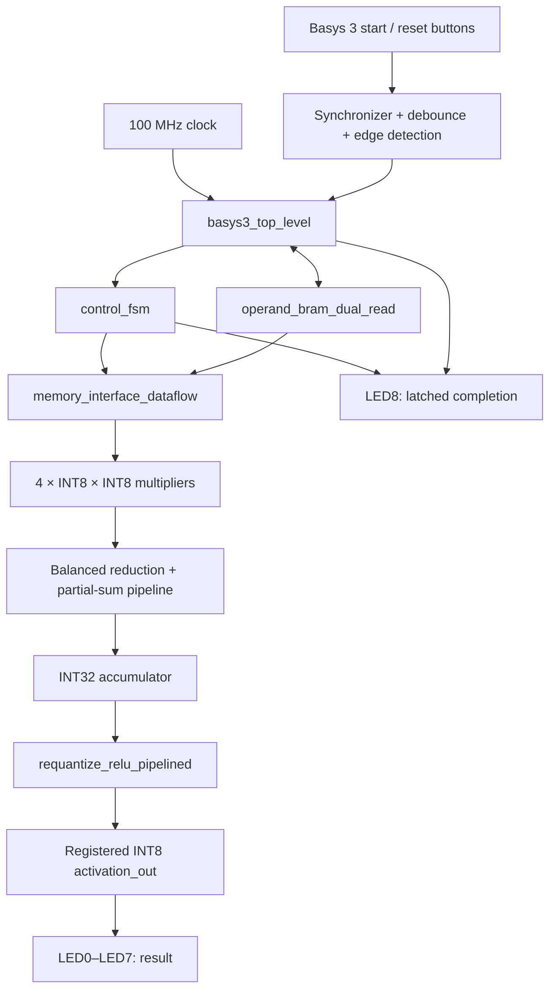

# Low-Power INT8 Neural Processing Unit on Basys 3

An architecture-first hardware/software co-design project for a small INT8 convolution accelerator implemented in Verilog RTL and targeted at the Digilent Basys 3 FPGA board (AMD/Xilinx Artix-7).

The project emphasizes understanding arithmetic, datapath scheduling, synchronous memory behavior, control sequencing, verification, synthesis, and timing closure—not simply producing RTL that appears to work.

> **Current repository milestone:** Phase 8 — Basys 3 top-level integration, physical validation, and final optimization. The Stage-2 timing-closure design review reports successful 100 MHz setup/hold/pulse-width closure. Behavioral and Vivado constraint verification are documented as passing. Physical operation on the actual Basys 3 board remains to be validated.

---

## Table of contents

- [Project overview](#project-overview)
- [Target specifications](#target-specifications)
- [Architecture](#architecture)
- [Datapath and numerical behavior](#datapath-and-numerical-behavior)
- [Current demonstration configuration](#current-demonstration-configuration)
- [Basys 3 board interface](#basys-3-board-interface)
- [Changing activations, weights, and quantization](#changing-activations-weights-and-quantization)
- [Repository structure](#repository-structure)
- [RTL module guide](#rtl-module-guide)
- [Python reference model](#python-reference-model)
- [Verification and simulation](#verification-and-simulation)
- [Vivado implementation flow](#vivado-implementation-flow)
- [Measured implementation results](#measured-implementation-results)
- [Engineering documentation](#engineering-documentation)
- [Known limitations and assumptions](#known-limitations-and-assumptions)
- [Development workflow](#development-workflow)
- [License](#license)

---

## Project overview

The design implements a single-channel 3 × 3 integer convolution:

\[
acc = \sum_{i=0}^{8} activation_i \times weight_i
\]

The nine signed INT8 activation/weight pairs are read from on-chip memory in three packed 32-bit words. Four INT8 multiplication lanes operate in parallel. Their products are reduced and accumulated into a signed INT32 result. The result then passes through fixed-point requantization, ReLU, rounding, and saturation to produce an INT8 activation.

At board level, a conditioned start-button press launches the accelerator. Eight LEDs display the result, and a ninth LED provides a persistent completion indication.

### Project objectives

1. Build a complete, understandable INT8 convolution datapath.
2. Derive and justify arithmetic widths instead of relying on implicit Verilog sizing.
3. Understand how four parallel multipliers process a nine-element convolution.
4. Preserve correct operand alignment with one-clock synchronous memory reads.
5. Separate transaction control from arithmetic datapath logic.
6. Implement fixed-point requantization and ReLU.
7. Verify modules independently and then verify the integrated accelerator.
8. Measure FPGA resource usage and close timing at the target 100 MHz clock.
9. Keep predicted results, simulated results, and physical measurements clearly distinguished.

## Target specifications

| Parameter | Current design target |
|---|---|
| FPGA board | Digilent Basys 3 |
| FPGA device | XC7A35T-1CPG236C |
| FPGA family | AMD/Xilinx Artix-7 |
| System clock | 100 MHz |
| Clock period | 10 ns |
| Convolution kernel | 3 × 3 |
| Input channels | 1 |
| Output channels | 1 |
| MAC/multiplier lanes | 4 parallel INT8 products per packed word |
| Activation precision | Signed INT8 |
| Weight precision | Signed INT8 |
| Product precision | Signed INT16 |
| Accumulator precision | Signed INT32 |
| Output precision | Signed INT8 |
| Activation function | ReLU |
| Quantization | Symmetric INT8 input quantization and fixed-point output requantization |
| Operand storage | Synchronous FPGA block RAM |
| Control | Finite-state machines |
| RTL | Verilog |
| Simulation | Vivado XSim |
| Software reference | Python |

The generated symmetric INT8 data contract uses the range **[-127, +127]**. Although a signed INT8 signal can represent -128, the quantization helper deliberately uses the symmetric range so that positive and negative magnitudes are balanced.

---

## Architecture

### High-level dataflow

The Basys 3 wrapper handles physical inputs and outputs. The convolution core handles transaction control, memory sequencing, arithmetic, and output capture.



### Main architectural blocks

1. **Board input conditioning:** synchronizes asynchronous pushbuttons, rejects short bounce transitions, and produces a one-clock start pulse.
2. **Supervisory controller:** accepts a legal start, launches the convolution engine, waits for its completion, captures the output activation, and generates the completion pulse.
3. **Operand memory:** supplies packed activation and weight words through synchronous read ports.
4. **Convolution dataflow engine:** performs four signed INT8 multiplications in parallel, registers the products, reduces them, and accumulates the three word contributions.
5. **Requantization and activation:** applies the fixed-point multiplier, rounding, right shift, ReLU behavior, and INT8 saturation.
6. **Board output logic:** exposes the registered result and latches the one-cycle completion event for LED visibility.

### Control structure

There are two distinct controllers:

- `control_fsm`: a five-state supervisory FSM in `rtl/control/control_fsm.v`. Its states are IDLE, LAUNCH, WAIT_ENGINE, CAPTURE_ACTIVATION, and DONE. Five states require three binary state bits because \(\lceil \log_2 5 \rceil = 3\).
- `memory_interface_dataflow`: a seven-state memory/compute sequencing FSM in `rtl/compute/memory_interface_dataflow.v`. Seven states also fit in three bits because \(\lceil \log_2 7 \rceil = 3\).

The arithmetic data does not pass through the supervisory FSM. The FSM controls when computation starts and when the completed activation is captured.

### Memory organization and scheduling

The current operand memory is declared as a 512 × 32-bit array with two synchronous read ports:

- Activation logical addresses 0, 1, and 2 map to physical addresses 0, 1, and 2.
- Weight logical addresses 0, 1, and 2 map to physical addresses 256, 257, and 258.
- Both read ports have one clock of read latency.
- Four signed INT8 values are packed into each 32-bit word.
- The final word contains one valid convolution element and three zero-padded lanes.

The engine consumes exactly three paired activation/weight read requests per transaction. Each paired request transfers one 32-bit activation word and one 32-bit weight word. Therefore:

\[
3\ \text{requests} \times (32 + 32)\ \text{bits}
= 192\ \text{bits}
= 24\ \text{bytes per convolution}
\]

The additional Stage-2 compute pipeline does not add memory requests.

### Compute pipeline

The current integrated engine uses the following sequence:

```text
Synchronous operand BRAM
        |
        v
Four signed INT8 × INT8 multipliers
        |
        v
Four registered INT16 products
        |
        v
Balanced reduction tree (16 -> 17 -> 18 bits)
        |
        v
Registered sign-extended partial sum (INT32)
        |
        v
INT32 accumulator
        |
        v
Final convolution result
```

The three packed words produce three partial sums:

- Word 0: products for elements 0–3.
- Word 1: products for elements 4–7.
- Word 2: product for element 8 plus three zero-padded products.

The Stage-2 design adds four 16-bit product registers. The register cost is derived directly:

\[
4\ \text{registers} \times 16\ \text{bits} = 64\ \text{flip-flops}
\]

The measured synthesis comparison reports an increase of 64 flip-flops from Stage 1 to Stage 2, matching this architectural addition.

---

## Datapath and numerical behavior

### INT8 multiplication

Each activation and weight is a signed two's-complement 8-bit value:

\[
-127 \leq a,w \leq 127
\]

The product is represented as signed INT16:

\[
p = a \times w
\]

The integrated dataflow uses four such products in parallel for each packed word.

### INT32 accumulation bound

For the configured 3 × 3, single-channel convolution, there are nine products. Under the symmetric generated INT8 range, the maximum positive sum is:

\[
acc_{max} = 9 \times 127 \times 127 = 145161
\]

Since:

\[
2^{17} = 131072 < 145161 < 262144 = 2^{18}
\]

the positive magnitude requires 18 unsigned bits. The architectural accumulator remains signed INT32 to provide a wider accumulation format and a clear interface to later processing.

**Important:** the 18-bit positive-magnitude extraction in the requantizer relies on this bounded 3 × 3 input contract. Increasing the kernel size, channel count, or operand range requires re-deriving the bound and reviewing the RTL widths.

### Fixed-point requantization

The software reference derives the real-valued multiplier:

\[
M = \frac{S_a \times S_w}{S_{out}}
\]

The hardware approximates it using a 24-bit unsigned integer coefficient:

\[
M \approx \frac{M_{INT}}{2^F}
\]

where:

- `M_INT` is the 24-bit unsigned coefficient.
- `FRAC_BITS` (\(F\)) is the compile-time right-shift amount.
- The supported parameter range in the RTL/Python contract is \(0 \leq F \leq 42\).

For a positive accumulator and \(F > 0\), the rounded value is:

\[
q_{pre} =
\left\lfloor
\frac{acc \times M_{INT} + 2^{F-1}}{2^F}
\right\rfloor
\]

For \(F=0\), no rounding bias or fractional shift is applied. ReLU and output saturation then produce:

\[
q =
\begin{cases}
0, & acc \leq 0 \\
127, & q_{pre} > 127 \\
q_{pre}, & 0 < q_{pre} \leq 127
\end{cases}
\]

The integrated design uses `requantize_relu_pipelined.v`, which registers the 42-bit multiplication result before the rounding, shift, and saturation logic. The convolution integration module then captures the resulting INT8 value in its architectural `activation_out` register.

---

## Current demonstration configuration

The board demonstration currently uses fixed operands initialized in `rtl/memory/operand_bram_dual_read.v`.

### Activation values

`[1, 2, 3, 4, 5, 6, 7, 8, 9]`

| Memory word | Packed hexadecimal value | Valid lanes |
|---|---|---|
| Activation word 0 | `0x04030201` | 1, 2, 3, 4 |
| Activation word 1 | `0x08070605` | 5, 6, 7, 8 |
| Activation word 2 | `0x00000009` | 9, 0, 0, 0 |

### Weight values

`[1, 1, 1, 1, 1, 1, 1, 1, 1]`

| Memory word | Packed hexadecimal value | Valid lanes |
|---|---|---|
| Weight word 0 | `0x01010101` | 1, 1, 1, 1 |
| Weight word 1 | `0x01010101` | 1, 1, 1, 1 |
| Weight word 2 | `0x00000001` | 1, 0, 0, 0 |

Lane order is little-lane order: lane 0 occupies bits [7:0], lane 1 occupies [15:8], lane 2 occupies [23:16], and lane 3 occupies [31:24].

### Demonstration arithmetic

The convolution result is:

\[
acc = 1+2+3+4+5+6+7+8+9 = 45
\]

The Basys 3 top-level overrides the requantization parameters with:

- `M_INT = 3`
- `FRAC_BITS = 2\)

Therefore:

\[
q = (45 \times 3 + 2) \gg 2
= 137 \gg 2
= 34
\]

The expected output is:

- Decimal: `34`
- Hexadecimal: `0x22`
- Binary: `0010_0010`

Thus result LED bits 1 and 5 illuminate. The completion indicator is LED8.

This is a deterministic demonstration vector, not a trained neural-network model or a runtime inference interface.

---

## Basys 3 board interface

The current top-level module is `rtl/top/basys3_top_level.v`. The XDC file is `vivado/constraints/basys3_top_level.xdc`.

### Clock and pushbuttons

| Top-level signal | Basys 3 resource | Package pin | Purpose |
|---|---|---|---|
| `clk_100mhz` | 100 MHz oscillator | W5 | System clock |
| `btn_start` | Center button (btnC) | U18 | Start a convolution |
| `btn_reset` | Down button (btnD) | U17 | Reset the design |

The clock period is constrained to 10 ns:

\[
T = \frac{1}{100\,\text{MHz}} = 10\,\text{ns}
\]

The default debounce threshold is 1,000,000 stable clock cycles. At 100 MHz:

\[
\frac{1,000,000\ \text{cycles}}{100,000,000\ \text{cycles/second}}
= 0.01\ \text{seconds}
= 10\ \text{ms}
\]

Simulation reduces the debounce threshold to four cycles while retaining the real 10 ns clock period.

### Result and completion LEDs

| Top-level signal | Basys 3 LED | Package pin |
|---|---|---|
| `led_result[0]` | LED0 | U16 |
| `led_result[1]` | LED1 | E19 |
| `led_result[2]` | LED2 | U19 |
| `led_result[3]` | LED3 | V19 |
| `led_result[4]` | LED4 | W18 |
| `led_result[5]` | LED5 | U15 |
| `led_result[6]` | LED6 | U14 |
| `led_result[7]` | LED7 | V14 |
| `led_done` | LED8 | V13 |

All 12 exposed board ports use `LVCMOS33`. The XDC also sets `CONFIG_VOLTAGE = 3.3` and `CFGBVS = VCCO`.

**No slide switches are currently connected to the NPU inputs.** The current board interface uses two pushbuttons and nine LEDs. Activations and weights are initialized in RTL memory.

### Start and completion behavior

- A start press is synchronized, debounced, and converted into a one-clock rising-edge pulse.
- A start pulse received while the accelerator is busy is discarded; it is not queued.
- The core's raw `done` is a one-cycle event.
- The board wrapper stores that event in `done_latched`, so LED8 remains on until a new start or reset.
- The result LEDs are driven from the architectural `activation_out` register.
- Reset is synchronized/debounced at the board boundary and then applied as a synchronous active-high core reset.

---

## Changing activations, weights, and quantization

The current design supports **configuration-time changes**, not live editing through the Basys 3 switches or buttons.

### 1. Change the activation values

Edit:

`rtl/memory/operand_bram_dual_read.v`

Update the three activation initialization words:

- `mem[0]`
- `mem[1]`
- `mem[2]`

Keep the nine values packed as 4 + 4 + 1. The fourth lane of the final word must remain zero unless the architecture and padding rules are intentionally changed.

### 2. Change the weight values

In the same file, update:

- `mem[256]`
- `mem[257]`
- `mem[258]`

These are the three weight words because `WEIGHT_BASE = 256`.

### 3. Pack signed INT8 values correctly

The helper functions in `python/quantization/int8_quantizer.py` include:

- `pack_four_int8(values)`
- `pack_3x3_to_words(values)`
- `format_mem_words(words)`

They pack four signed 8-bit values per 32-bit word, with lane 0 in the least-significant byte. Negative values are represented in two's-complement form.

After editing the RTL initialization values, rerun the Python reference test, run the relevant XSim testbench, and regenerate the FPGA bitstream before expecting the physical board to show the new result.

### 4. Change the requantization scale

Edit the parameters passed by `rtl/top/basys3_top_level.v` to `convolution_integration`:

```verilog
.M_INT     (24'd3),
.FRAC_BITS (2)
```

Use the Python helper `derive_requantization_params(s_a, s_w, s_out)` to derive a compatible `M_INT` and `FRAC_BITS` from the quantization scales. Keep `M_INT` within the unsigned 24-bit range and `FRAC_BITS` within 0..42.

The board top-level values override the defaults in `convolution_integration`. Changing only a default parameter in a lower-level module will not change the board demonstration if the top-level override remains in place.

**Every change to memory initialization or compile-time requantization parameters requires rebuilding and reprogramming the bitstream.** Runtime operand loading, UART, a host interface, and switch-based data entry are not implemented in the current repository.

---

## Repository structure

The following tree reflects the files currently present on the default branch. It intentionally does not list planned directories that do not yet exist.

```text
low-power-npu-basys3/
├── README.md
├── PROJECT_PLAN.md
├── rtl/
│   ├── primitives/
│   │   ├── int8_arithmetic.v
│   │   └── int32_accumulator.v
│   ├── compute/
│   │   ├── 4mac_datapath.v
│   │   └── memory_interface_dataflow.v
│   ├── activation/
│   │   ├── relu_activation.v
│   │   ├── relu_timing_wrapper.v
│   │   ├── requantize_relu.v
│   │   ├── requantize_relu_pipelined.v
│   │   └── requantize_timing_wrapper.v
│   ├── memory/
│   │   └── operand_bram_dual_read.v
│   ├── control/
│   │   └── control_fsm.v
│   ├── infrastructure/
│   │   └── button_conditioner.v
│   └── top/
│       ├── convolution_integration.v
│       └── basys3_top_level.v
├── tb/
│   ├── unit/
│   │   ├── tb_4mac_datapath.v
│   │   ├── tb_control_fsm.v
│   │   ├── tb_int32_accumulator.v
│   │   ├── tb_int8_arithmetic.v
│   │   ├── tb_relu_activation.v
│   │   ├── tb_relu_timing_wrapper.v
│   │   ├── tb_requantize_relu.v
│   │   └── tb_requantize_relu_pipelined.v
│   ├── integration/
│   │   ├── tb_memory_interface_dataflow.v
│   │   ├── tb_convolution_integration.v
│   │   └── tb_basys3_top_level.v
│   └── scripts/
│       └── verify_basys3_xdc.tcl
├── python/
│   ├── quantization/
│   │   └── int8_quantizer.py
│   └── verification/
│       └── test_int8_quantizer.py
├── vivado/
│   └── constraints/
│       ├── basys3_top_level.xdc
│       ├── relu_timing_wrapper.xdc
│       └── requantize_timing_wrapper.xdc
└── docs/
    ├── learning/
    ├── design/
    ├── verification/
    ├── analysis/
    └── design_review/
```

The repository currently contains 14 RTL files, 8 unit testbenches, 3 integration testbenches, 2 Python files, 3 XDC files, and a Vivado XDC verification Tcl script. The documentation directories contain the detailed learning, design, verification, analysis, and review records.

There is currently no checked-in `mem/` directory, generated memory image, Vivado `.xpr` project, automated full-build Tcl flow, or generated bitstream. The board demonstration operands are initialized directly in RTL.

---

## RTL module guide

| File | Responsibility |
|---|---|
| `rtl/primitives/int8_arithmetic.v` | Standalone signed INT8 multiplication and INT16-to-INT32 sign extension primitive |
| `rtl/primitives/int32_accumulator.v` | Standalone enabled INT32 accumulator |
| `rtl/compute/4mac_datapath.v` | Standalone four-MAC scheduling/datapath exercise |
| `rtl/compute/memory_interface_dataflow.v` | Integrated three-word convolution sequencing, four product registers, reduction, partial-sum pipeline, and INT32 accumulation |
| `rtl/activation/relu_activation.v` | Combinational INT32 ReLU with signed INT8 saturation |
| `rtl/activation/requantize_relu.v` | Combinational fixed-point requantization, rounding, ReLU, and saturation reference implementation |
| `rtl/activation/requantize_relu_pipelined.v` | Integrated timing-refined requantization implementation |
| `rtl/activation/relu_timing_wrapper.v` | Register-to-register ReLU timing measurement wrapper |
| `rtl/activation/requantize_timing_wrapper.v` | Requantization timing/resource measurement wrapper |
| `rtl/memory/operand_bram_dual_read.v` | 512 × 32 synchronous operand memory with activation and weight read ports |
| `rtl/control/control_fsm.v` | Supervisory transaction controller |
| `rtl/infrastructure/button_conditioner.v` | Two-flop synchronizer, debounce counter, and rising-edge pulse generator |
| `rtl/top/convolution_integration.v` | Integrates controller, memory dataflow engine, requantizer, and registered output |
| `rtl/top/basys3_top_level.v` | Basys 3 board wrapper, button conditioning, operand memory, result LEDs, and latched done LED |

**Integration note:** the standalone `four_mac_datapath`, `int8_arithmetic`, and `int32_accumulator` modules are independently useful RTL learning/verification blocks. The final integrated convolution path is implemented by `memory_interface_dataflow`; it contains its own packed-lane multiplication, reduction, and accumulation logic. Similarly, the integrated path uses `requantize_relu_pipelined`, not the standalone combinational ReLU timing wrapper.

---

## Python reference model

### `python/quantization/int8_quantizer.py`

This module provides software-side numerical helpers independent of the RTL implementation:

- Symmetric scale derivation.
- Symmetric INT8 quantization and dequantization.
- Round-to-nearest with ties away from zero for signed quantization.
- ReLU output-scale derivation.
- Fixed-point requantization coefficient generation.
- Independent 3 × 3 integer convolution.
- ReLU/requantization reference behavior.
- Four-lane INT8 packing and memory-word formatting.

### `python/verification/test_int8_quantizer.py`

Directed Python checks cover scale derivation, signed rounding, clipping, maximum 3 × 3 accumulation, coefficient selection, memory packing, and requantization corner cases.

Run from the repository root:

```bash
python python/verification/test_int8_quantizer.py
```

The expected successful terminal summary is:

```text
PY_INT8_QUANTIZER_PASS: all directed checks passed
```

---

## Verification and simulation

Verification is organized at three levels.

### Unit testbenches

| Testbench | Main target |
|---|---|
| `tb/unit/tb_int8_arithmetic.v` | Signed INT8 multiplication and sign extension |
| `tb/unit/tb_int32_accumulator.v` | Accumulator reset, enable, and accumulation |
| `tb/unit/tb_4mac_datapath.v` | Standalone four-MAC scheduling and result |
| `tb/unit/tb_relu_activation.v` | ReLU and INT8 saturation |
| `tb/unit/tb_requantize_relu.v` | Combinational fixed-point requantization |
| `tb/unit/tb_requantize_relu_pipelined.v` | Product pipeline, rounding, saturation, reset, and back-to-back samples |
| `tb/unit/tb_control_fsm.v` | Supervisory control protocol |
| `tb/unit/tb_relu_timing_wrapper.v` | Registered timing wrapper behavior |

### Integration testbenches

- `tb/integration/tb_memory_interface_dataflow.v`: memory request sequence, returned word alignment, products, partial sums, and accumulator result.
- `tb/integration/tb_convolution_integration.v`: controller-to-engine-to-requantizer integration and output capture.
- `tb/integration/tb_basys3_top_level.v`: board wrapper, button conditioning, busy masking, memory protocol, pipeline alignment, reset/recovery, latency, result LEDs, and persistent completion indication.

The latest Stage-2 top-level behavioral verification record reports zero errors. It checks the four product lanes for each of the three words, partial sums 10, 26, and 9, accumulator progression 0 → 10 → 36 → 45, final activation 34, exactly three paired memory requests in address order 0 → 1 → 2, and 90 ns accepted-start-to-done latency.

A passing testbench is evidence for the assertions it actually checks; it is not proof of physical timing, BRAM inference, board operation, or exhaustive behavior for every parameter combination.

### Vivado XDC verification

`tb/scripts/verify_basys3_xdc.tcl` checks the live Vivado design/constraint database. It verifies port resolution, package pins, I/O standards, unique pin use, the 100 MHz clock object, and configuration properties.

Run it only after opening the Basys 3 design in Vivado with the XDC loaded, for example after synthesis:

```tcl
source tb/scripts/verify_basys3_xdc.tcl
```

The documented XDC verification reports all 12 board ports resolved, 12 unique package pins, LVCMOS33 on all ports, one 10 ns primary clock, and the expected configuration properties. This is constraint verification, not a substitute for timing or hardware validation.

---

## Vivado implementation flow

The repository contains RTL and constraints, but it does not currently include a generated Vivado project file or a complete automated build script. Create a Vivado RTL project and add the checked-in sources.

### Create the hardware project

1. Open AMD/Xilinx Vivado and create an RTL project.
2. Select the Basys 3 device `XC7A35T-1CPG236C`.
3. Add the Verilog files under `rtl/` as design sources.
4. Set `basys3_top_level` as the synthesis top module.
5. Add `vivado/constraints/basys3_top_level.xdc` as the active constraints file.
6. Run elaboration and synthesis.
7. Run implementation and inspect setup, hold, and pulse-width timing.
8. Generate the bitstream only after the implementation checks are satisfactory.
9. Program the Basys 3 board and perform the physical button/LED validation.

Do not add testbench files as synthesis design sources.

### Run behavioral simulation

1. Add the RTL sources to the Vivado project.
2. Add the required testbench from `tb/unit/` or `tb/integration/` as a simulation source.
3. Select the corresponding testbench module as the simulation top.
4. Run behavioral simulation in XSim.
5. Inspect the testbench checks and waveforms; explain the signal relationships behind each pass result.

For the complete board-wrapper regression, select `tb_basys3_top_level` from `tb/integration/tb_basys3_top_level.v`.

### Implementation evidence to retain

For each implementation revision, retain:

- Synthesis utilization report.
- Implemented utilization report.
- Post-route timing summary.
- Worst setup and hold path reports.
- Clock and constraint reports.
- XSim logs and testbench summaries.
- The exact RTL revision and parameter values used.

A successful bitstream generation alone is not proof of timing closure or correct physical board operation.

---

## Measured implementation results

The following figures are recorded in `docs/design_review/basys3_timing_closure_stage2.md`. They describe the documented Stage-2 implementation and must not be confused with the earlier timing-closure iterations.

### Timing-closure progression

| Architecture revision | Worst path delay | WNS | TNS | Failing setup endpoints |
|---|---:|---:|---:|---:|
| Original datapath | 13.433 ns | -3.453 ns | -99.753 ns | 43 |
| Stage 1: partial-sum pipeline | 11.289 ns | -1.260 ns | -9.347 ns | 12 |
| Stage 2: four product registers plus partial-sum pipeline | 8.996 ns | +0.913 ns | 0 ns | 0 |

The Stage-2 timing report records:

| Timing metric | Measured result |
|---|---:|
| Clock period | 10.000 ns |
| Setup WNS | +0.913 ns |
| Setup TNS | 0.000 ns |
| Hold WHS | +0.122 ns |
| Hold THS | 0.000 ns |
| Pulse-width slack | +4.500 ns |
| Setup failing endpoints | 0 |
| Hold failing endpoints | 0 |
| Pulse-width failing endpoints | 0 |

The final worst setup path is from the weight BRAM output register through an INT8 multiplier to a product pipeline register. The reported data-path delay is 8.996 ns and the reported slack is +0.913 ns.

The clock requirement remained 100 MHz / 10 ns. The documented timing fix was achieved by inserting sequential pipeline boundaries in the datapath; the design review reports that no false-path or multicycle exception was introduced to hide the original setup violations.

### Final Stage-2 synthesis utilization

| Resource | Measured count |
|---|---:|
| Slice LUTs | 525 |
| Flip-flops | 218 |
| CARRY4 | 96 |
| DSP48E1 | 0 |
| RAMB18E1 | 2 |
| IOB | 12 |
| BUFG | 1 |

The two RAMB18E1 blocks implement the dual-read operand storage. The documented arithmetic implementation uses LUT/carry logic rather than DSP48E1 blocks.

### Transaction latency derivation

The Stage-2 behavioral verification measures nine clock cycles from the accepted `core_start` edge to the raw completion event.

At 100 MHz:

\[
T_{clk} = \frac{1}{100\,\text{MHz}} = 10\,\text{ns}
\]

\[
T_{transaction} = 9 \times 10\,\text{ns} = 90\,\text{ns}
\]

The timing-closure iterations therefore changed the measured latency from 70 ns (original) to 80 ns (Stage 1) and then 90 ns (Stage 2). The additional latency is the explicit cost of the pipeline stages that enable the documented 100 MHz timing closure.

### Verification status

| Area | Repository evidence |
|---|---|
| Unit-level arithmetic/control/activation tests | Testbenches present |
| Integrated convolution simulation | Verification record present |
| Stage-2 top-level simulation | Documented PASS, zero errors |
| Stage-2 latency | 90 ns / 9 cycles, checked in XSim |
| XDC database verification | Documented PASS in Vivado |
| Stage-2 synthesis resources | Measured results documented |
| Stage-2 post-route timing | Documented setup, hold, and pulse-width PASS |
| Physical Basys 3 operation | Pending hardware validation |
| Power measurement | Not yet documented |

**Historical-document note:** some earlier top-level analysis and simulation documents describe the pre-Stage-2 70 ns implementation. The current RTL contains the Stage-2 product pipeline. Use the Stage-2 verification measurement and Stage-2 design review as the current latency/timing records; retain earlier documents as historical design iterations.

---

## Engineering documentation

The `docs/` directory is the detailed engineering record. The README is an entry point, not a replacement for the module-level derivations and verification evidence.

### Learning — `docs/learning/`

Conceptual explanations and understanding checkpoints, including:

- `int8_arithmetic.md`
- `int32_accumulator.md`
- `4mac_scheduling.md`
- `int8_quantization.md`
- `relu_activation.md`
- `memory_interface_dataflow.md`
- `convolution_integration.md`
- `control_fsm.md`
- `basys3_top_level.md`
- `basys3_timing_closure.md`

### Design — `docs/design/`

RTL architecture, interfaces, state sequencing, pipeline boundaries, timing refinements, and implementation decisions.

### Verification — `docs/verification/`

Test plans, testbench design, XSim measurements, numerical checks, memory protocol checks, reset/recovery behavior, and timing-closure verification. Particularly useful current records include:

- `basys3_timing_closure_stage2.md`
- `basys3_timing_closure_stage2_measurement.md`
- `basys3_xdc_measurement.md`
- `basys3_top_level_simulation.md` (earlier 70 ns baseline)

### Analysis — `docs/analysis/`

Mathematical predictions, cycle schedules, resource estimates, timing analysis, measured-versus-predicted updates, and hardware-validation predictions.

### Design review — `docs/design_review/`

Review decisions and acceptance records. The current timing-closure review is:

- `docs/design_review/basys3_timing_closure_stage2.md`

The top-level board integration review is:

- `docs/design_review/basys3_top_level.md`

### Project roadmap

See [`PROJECT_PLAN.md`](PROJECT_PLAN.md) for the learning/build roadmap, reference parameters, module workflow, and project success criteria.

---

## Known limitations and assumptions

1. **Single-channel scope:** the current integrated convolution is 3 × 3 with one input channel and one output channel. General multi-channel convolution is not implemented.
2. **Fixed demonstration operands:** activations and weights are initialized in RTL. There is no runtime memory-loading interface or switch-based operand editor.
3. **Compile-time quantization:** `M_INT` and `FRAC_BITS` are parameters. Changing them requires rebuilding the bitstream.
4. **Bounded input range:** the requantizer's 18-bit positive magnitude relies on the symmetric INT8 range and the 3 × 3 single-channel maximum of 145161. A wider workload requires a new range derivation and RTL review.
5. **Physical board test pending:** XSim and Vivado implementation evidence do not prove that the actual board buttons and LEDs have been tested successfully.
6. **Power not yet characterized:** the project is motivated by low-power hardware design, but no measured power result is claimed here.
7. **Tool versions are not pinned:** the repository does not currently provide a Vivado version lock, Python requirements file, or automated environment setup.
8. **Build automation is incomplete:** no Vivado `.xpr`, generated bitstream, or complete scripted build flow is checked in.
9. **Standalone learning blocks:** some primitive and timing-wrapper modules are independently tested but are not instantiated in the final integrated board datapath.
10. **License not specified:** no repository license file is currently present.

These limitations are intentional documentation boundaries: a planned feature or a predicted result must not be presented as implemented or measured.

---

## Development workflow

The project follows an architecture-first sequence:

```text
TEACH
  -> DESIGN
  -> ANALYZE / PREDICT
  -> USER CONFIRMS UNDERSTANDING
  -> RTL IMPLEMENTATION
  -> VERIFY
  -> TESTBENCH
  -> SIMULATE
  -> MEASURE
  -> COMPARE MEASURED VS PREDICTED
  -> DESIGN REVIEW
  -> KNOWLEDGE TEST
```

Non-negotiable engineering practices:

- Derive arithmetic widths, cycle counts, and resource estimates from first principles.
- State clock, memory-latency, and tool assumptions explicitly.
- Explain why each verification assertion passes; do not rely only on a final PASS banner.
- Separate predicted, simulated, synthesized, routed, and physically measured results.
- Do not advance to RTL implementation before the design concept and its derivation are understood.
- Update the relevant engineering document when measurements differ from predictions.

The goal is an accelerator whose numerical behavior, control protocol, memory traffic, latency, resource usage, and timing behavior can all be explained and defended in a hardware engineering design review.

---

## License

No `LICENSE` file is currently present in this repository. Until a license is added, reuse and redistribution permissions have not been explicitly granted.
